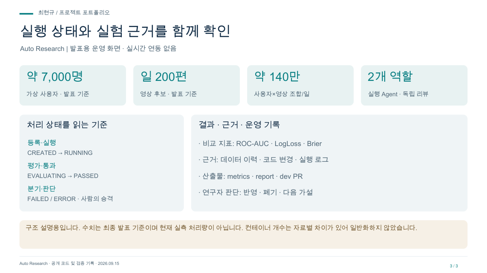

# Auto Research 발표 자료

가설 한 줄에서, 검토 가능한 실험 결과까지. 소개·처리 흐름·운영 관점으로 구성한 3장 자료입니다.

- [발표 PDF](project.pdf)
- [편집 가능한 PPT](project.pptx)
- [대시보드 미리보기](dashboard.png)

## 담당 범위

담당: 클라우드 인프라 · 배포 · 관측

## 검증 범위 · 2026-09-15

구조 설명용입니다. 수치는 최종 발표 기준이며 현재 실측 처리량이 아닙니다. 컨테이너 개수는 자료별 차이가 있어 일반화하지 않았습니다.

실시간 관제 서비스가 아닌 발표용 화면입니다. 수치는 검증 시점 또는 예시 범위를 따릅니다.
